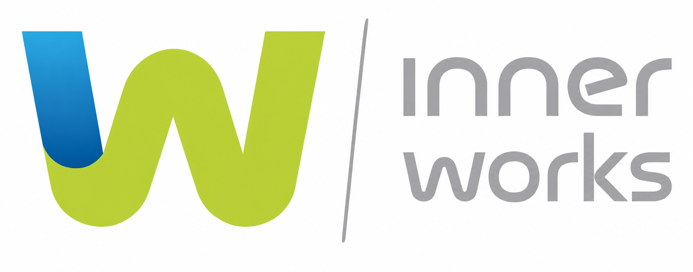
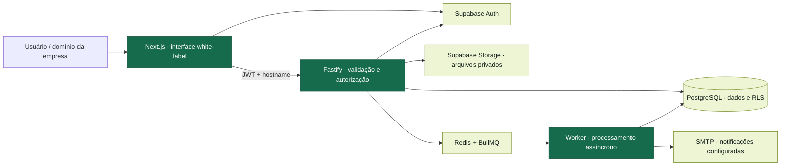
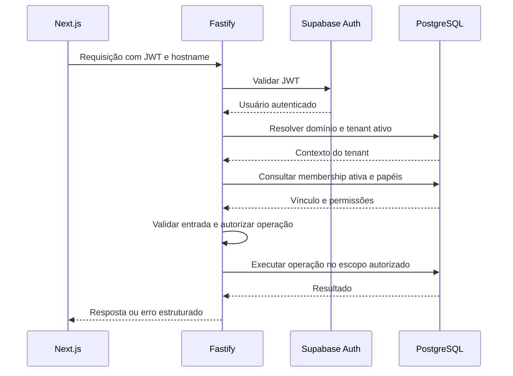

<a id="topo"></a>

<p align="center">
  
</p>

# Inner Almox

<p align="center">
  <strong>Patrimônio, materiais e frota em uma única operação.</strong><br>
  Plataforma corporativa SaaS, multi-tenant e white-label da InnerWorks.
</p>

<p align="center">
  <a href="#inicio-rapido">🚀 Rodar localmente</a> ·
  <a href="#modulos">📦 Explorar módulos</a> ·
  <a href="#arquitetura">🧩 Arquitetura</a> ·
  <a href="#documentacao">📚 Documentação</a>
</p>

> **Em desenvolvimento e preparação para homologação.** Consulte o [progresso do MVP](docs/TASKS.md) e a [auditoria funcional](docs/AUDITORIA-MVP.md) para acompanhar entregas e pendências. O [PRD](docs/PRD.md) é a fonte de verdade dos requisitos.

Este README usa links internos, diagramas Mermaid e seções expansíveis. Clique nos títulos com **▶** para abrir os detalhes; os diagramas são renderizados no GitHub.

## Navegação

| Conhecer o produto | Desenvolver e operar |
| --- | --- |
| [Visão geral](#visao-geral) | [Início rápido](#inicio-rapido) |
| [Módulos e fluxos](#modulos) | [Primeiro acesso](#primeiro-acesso) |
| [Arquitetura e isolamento](#arquitetura) | [Variáveis de ambiente](#ambiente) |
| [Stack e monorepo](#stack) | [Comandos e validação](#comandos) |
| [Documentação do projeto](#documentacao) | [Problemas comuns](#problemas-comuns) |
| [Como contribuir](#contribuir) | [Deploy e homologação](#deploy) |

<a id="visao-geral"></a>

## Visão geral

O Inner Almox centraliza o ciclo de vida de bens, insumos e veículos: cadastro, responsabilidade, movimentação, manutenção, inventário e histórico. Cada empresa possui seu próprio contexto de acesso, dados e identidade visual.

| Pergunta da operação | Recurso do projeto |
| --- | --- |
| Onde está o equipamento e quem o utiliza? | Ativos, localizações, responsáveis e movimentações |
| O que entrou, saiu ou precisa de reposição? | Produtos, lotes, saldos, transferências e requisições |
| Quem retirou o veículo e quanto ele percorreu? | Motoristas, utilizações, checklists e quilometragem |
| Quais documentos e garantias estão vencendo? | Garantias, documentos, alertas e notificações |
| O inventário físico confere com os registros? | Campanhas, leitura de QR Code e divergências |
| Como comprovar uma entrega ou investigar uma ação? | Termos, aceite, relatórios e trilha de auditoria |

[↑ Voltar ao início](#topo)

<a id="modulos"></a>

## Módulos e fluxos

Expanda um domínio para conhecer seus principais recursos. A disponibilidade na interface depende dos módulos habilitados e dos papéis do usuário; o estado de implementação está em [docs/TASKS.md](docs/TASKS.md).

<details>
<summary><strong>▶ Patrimônio, documentos e inventário</strong></summary>

- Ativos individualizados, categorias, campos personalizados e vínculos organizacionais.
- QR Code individual, etiquetas em lote, fotos e documentos em armazenamento privado.
- Entregas, devoluções, empréstimos e transferências com histórico imutável.
- Termos de responsabilidade, aceite, PDF e consulta pública por código de validação.
- Campanhas de inventário, leitura de QR Code, registro e tratamento de divergências.

**Fluxo de referência:** cadastrar ativo → vincular localização e responsável → registrar movimentação → emitir termo → conferir no inventário.

[Rotas de patrimônio e documentos](docs/API.md) · [Requisitos funcionais](docs/PRD.md)

</details>

<details>
<summary><strong>▶ Almoxarifado e requisições</strong></summary>

- Produtos, unidades de medida, locais de estoque, lotes e validade.
- Entradas, saídas, ajustes e transferências entre estoques.
- Requisições com itens, transições de aprovação e atendimento.
- Operações transacionais e validação de saldo no PostgreSQL.
- Inventário de estoque e relatórios de saldos e movimentações.

**Fluxo de referência:** cadastrar produto → registrar entrada → solicitar material → aprovar → atender requisição → registrar saída.

[API de almoxarifado](docs/API.md) · [Regras e funções do banco](docs/DATABASE.md)

</details>

<details>
<summary><strong>▶ Frota e manutenção</strong></summary>

- Veículos, motoristas, autorizações, reservas e documentos.
- Retirada e devolução com checklists e controle de quilometragem.
- Abastecimentos, despesas, multas e ocorrências.
- Garantias, planos preventivos, ordens de manutenção e custos.
- Histórico de utilização e exportação de relatórios.

**Fluxo de referência:** cadastrar veículo e motorista → autorizar uso → retirar com checklist → devolver com quilometragem final → registrar custos.

[API de frota e manutenção](docs/API.md) · [Regras de negócio](docs/PRD.md)

</details>

<details>
<summary><strong>▶ Administração, white-label e visão do colaborador</strong></summary>

- Filiais, setores, centros de custo, localizações e fornecedores.
- Usuários, convites, memberships e papéis por empresa.
- Identidade visual e configurações do tenant.
- Visões pessoais de ativos, termos, requisições e notificações.
- Administração global de tenants, domínios, planos e módulos.
- Dashboard geral, exportações CSV/XLSX e auditoria de operações.

As telas de permissões, dashboards de módulo, saúde e acompanhamento de jobs possuem evolução registrada na [auditoria do MVP](docs/AUDITORIA-MVP.md) e no [progresso](docs/TASKS.md).

[Modelo de segurança](docs/SECURITY.md) · [Arquitetura](docs/ARCHITECTURE.md)

</details>

[↑ Voltar ao início](#topo)

<a id="arquitetura"></a>

## Arquitetura e isolamento



**Como uma empresa é isolada:** a API valida a sessão, resolve um domínio verificado de tenant ativo e exige uma membership ativa nesse tenant. O `tenant_id` do corpo da requisição não concede acesso.

As tabelas de negócio usam `tenant_id`, RLS e relações protegidas contra vínculos entre empresas. Como a service role contorna o RLS, a API aplica explicitamente o escopo de tenant e de papel antes de consultar ou alterar dados. Essa chave permanece no servidor.

<details>
<summary><strong>▶ Acompanhar uma requisição autenticada</strong></summary>



Operações críticas usam funções SQL transacionais. Arquivos são enviados e baixados por URLs assinadas; históricos sensíveis preservam rastreabilidade.

[Detalhes da arquitetura](docs/ARCHITECTURE.md) · [Modelo de confiança](docs/SECURITY.md) · [Decisões técnicas](docs/DECISIONS.md)

</details>

[↑ Voltar ao início](#topo)

<a id="stack"></a>

## Stack e monorepo

Versões declaradas nos manifests e na configuração do repositório:

| Camada | Tecnologias |
| --- | --- |
| Interface | Next.js 16, React 19, TypeScript, Tailwind CSS 4 e componentes shadcn/ui |
| API | Node.js 22+, Fastify 5 e Zod |
| Dados e identidade | Supabase PostgreSQL 17, Auth, Storage e RLS |
| Processamento | Redis 8 e BullMQ |
| Ferramentas | pnpm 10.26.2, Turborepo, ESLint, Vitest e pgTAP |
| Ambiente local | Docker e Docker Compose |

```text
Inner-Almox/
├── apps/
│   ├── web/                 # Interface Next.js com App Router
│   ├── api/                 # API Fastify e serviços de negócio
│   └── worker/              # Filas, alertas e notificações
├── packages/                # Espaço reservado a contratos e código compartilhado
├── supabase/
│   ├── migrations/          # Schema e regras em SQL versionado
│   ├── tests/               # Testes de banco e isolamento
│   ├── seed.sql             # Tenant e domínios locais
│   └── config.toml          # Configuração do Supabase local
├── docs/                    # PRD, arquitetura, API, segurança e progresso
├── infra/                   # Orientações de deploy e roteiro de aceitação
├── .env.example             # Modelo de configuração sem credenciais
└── docker-compose.yml       # Redis para desenvolvimento
```

Os diretórios de `packages/` documentam sua finalidade; código compartilhado será extraído conforme houver reutilização concreta. Consulte o [ADR-006](docs/DECISIONS.md).

<a id="inicio-rapido"></a>

## Início rápido

### 1. Preparar o ambiente

- Node.js **22 ou superior** e Corepack disponível.
- pnpm **10.26.2**, definido em [`package.json`](package.json).
- Git e Docker com suporte a Compose; no Windows, Docker Desktop em execução.
- Execute os comandos na raiz do repositório.

<details open>
<summary><strong>▶ Windows · PowerShell</strong></summary>

```powershell
git clone https://github.com/InnerworksBR/Inner-Almox.git
Set-Location Inner-Almox
corepack enable
pnpm install
if (-not (Test-Path .env)) { Copy-Item .env.example .env }
docker compose up -d redis
pnpm db:start
```

</details>

<details>
<summary><strong>▶ Linux / macOS · Bash</strong></summary>

```bash
git clone https://github.com/InnerworksBR/Inner-Almox.git
cd Inner-Almox
corepack enable
pnpm install
test -f .env || cp .env.example .env
docker compose up -d redis
pnpm db:start
```

</details>

Já possui o checkout? Comece em `corepack enable`, dentro da pasta do projeto.

### 2. Configurar as chaves locais

Após a inicialização, consulte as informações do Supabase:

```bash
pnpm exec supabase status
```

Preencha o `.env` da raiz com a URL da API Supabase e as chaves locais:

| Informação do Supabase | Variáveis no `.env` |
| --- | --- |
| API URL | `SUPABASE_URL` e `NEXT_PUBLIC_SUPABASE_URL` |
| anon key | `SUPABASE_ANON_KEY` e `NEXT_PUBLIC_SUPABASE_ANON_KEY` |
| service_role key | `SUPABASE_SERVICE_ROLE_KEY`, exclusivamente no servidor |

A URL do Supabase é diferente de `API_URL` / `NEXT_PUBLIC_API_URL`, que apontam para o Fastify. Mantenha as URLs locais de [`.env.example`](.env.example) ao usar as portas padrão.

### 3. Aplicar migrations e iniciar as aplicações

> `pnpm db:reset` recria o banco **local**, aplica migrations e seed e apaga dados existentes nele. Use no setup inicial ou quando puder descartar os dados de desenvolvimento.

```bash
pnpm db:reset
pnpm dev
```

O `pnpm dev` inicia web, API e worker em paralelo. As aplicações carregam o `.env` da raiz; reinicie os processos quando alterar as variáveis.

### 4. Abrir os serviços

| Serviço | Endereço local | Uso |
| --- | --- | --- |
| Web | [localhost:3000](http://localhost:3000) | Interface e login |
| API | [localhost:3333/health](http://localhost:3333/health) | Verificar resposta do Fastify |
| Supabase API | [127.0.0.1:54321](http://127.0.0.1:54321) | Auth, REST e Storage |
| Supabase Studio | [127.0.0.1:54323](http://127.0.0.1:54323) | Administração do ambiente local |
| E-mails locais | [127.0.0.1:54324](http://127.0.0.1:54324) | Inspecionar e-mails do Auth local |
| Redis | `redis://localhost:6379` | Conexão das filas |

O [seed](supabase/seed.sql) cadastra o tenant InnerWorks e vincula `localhost` e `api.localhost`. Acesse a **web por `localhost`** para usar esse contexto.

[Continuar: primeiro acesso →](#primeiro-acesso)

<a id="primeiro-acesso"></a>

## Primeiro acesso

O seed cria a empresa e o branding. O primeiro usuário precisa ser criado no Supabase Auth e receber um vínculo ativo com papel no tenant.

<details>
<summary><strong>▶ Provisionar o primeiro administrador no ambiente local</strong></summary>

1. Abra o [Supabase Studio](http://127.0.0.1:54323), entre em **Authentication → Users** e crie um usuário com e-mail e senha definidos por você. Confirme o e-mail para permitir o login.
2. No **SQL Editor** local, substitua o e-mail abaixo pelo e-mail desse usuário e execute:

   ```sql
   select public.provision_tenant_membership(
     '00000000-0000-0000-0000-000000000001'::uuid,
     (select id from auth.users where email = 'admin@innerworks.local'),
     array['tenant_admin']::text[],
     '{}'::jsonb
   );
   ```

3. Abra a [interface](http://localhost:3000) e entre com as credenciais criadas.
4. Envie os próximos convites em **Administração → Usuários**.

O UUID é o tenant de desenvolvimento definido no seed. A função está versionada nas [migrations](supabase/migrations/); esse bootstrap é uma operação administrativa local.

</details>

**Administração global:** para acessar os recursos InnerWorks da plataforma, configure `PLATFORM_ADMIN_EMAILS` com os e-mails autorizados, separados por vírgula, e reinicie a API. Esse acesso global é independente do papel `tenant_admin`.

**Acesso negado após o login?** Confira a confirmação do e-mail, a membership ativa, os papéis e o domínio utilizado. Veja [problemas comuns](#problemas-comuns).

[↑ Voltar ao início](#topo)

<a id="ambiente"></a>

## Variáveis de ambiente

Use [`.env.example`](.env.example) como referência completa. O `.env` local não deve ser versionado.

<details>
<summary><strong>▶ Configuração necessária para desenvolvimento</strong></summary>

| Variáveis | Finalidade |
| --- | --- |
| `NODE_ENV` | Ambiente da aplicação |
| `APP_URL`, `API_URL`, `NEXT_PUBLIC_API_URL` | Endereços da web e do Fastify |
| `PORT`, `HOST` | Porta e interface de rede da API |
| `SUPABASE_URL`, `NEXT_PUBLIC_SUPABASE_URL` | Endereço do Supabase |
| `SUPABASE_ANON_KEY`, `NEXT_PUBLIC_SUPABASE_ANON_KEY` | Chave pública para Auth e acesso sujeito a RLS |
| `SUPABASE_SERVICE_ROLE_KEY` | Operações autorizadas da API e do worker |
| `REDIS_URL` | Conexão das filas BullMQ |
| `WEB_ORIGINS` | Origens permitidas pelo CORS, separadas por vírgula |
| `TRUST_PROXY` | Confiança nos headers encaminhados pelo proxy; padrão local `false` |

As variáveis `NEXT_PUBLIC_*` são públicas e incorporadas à aplicação web. A service role nunca recebe esse prefixo nem vai para o navegador. Consulte o [ADR-004](docs/DECISIONS.md).

</details>

<details>
<summary><strong>▶ Opções de administração, filas e notificações</strong></summary>

| Variáveis | Finalidade |
| --- | --- |
| `PLATFORM_ADMIN_EMAILS` | Lista explícita de bootstrap dos administradores globais |
| `QUEUE_VALIDATION_ENABLED` | Habilitar a fila de validação da fundação |
| `QR_CODE_BASE_URL` | Base dos links usados pelos QR Codes |
| `DOCUMENT_PUBLIC_URL` | Base dos links de validação documental |
| `SMTP_HOST`, `SMTP_PORT`, `SMTP_FROM` | Configuração de envio por e-mail no worker |
| `SMTP_USER`, `SMTP_PASSWORD` | Credenciais SMTP, quando o servidor exigir |

O template também reserva `SENTRY_DSN`; sua presença não confirma integração ativa de observabilidade. A configuração SMTP e a entrega automática de alertas devem ser conferidas no [progresso](docs/TASKS.md) e na [auditoria](docs/AUDITORIA-MVP.md).

</details>

<a id="comandos"></a>

## Comandos e validação

| Objetivo | Comando |
| --- | --- |
| Instalar dependências | `pnpm install` |
| Iniciar todas as aplicações | `pnpm dev` |
| Gerar builds de produção | `pnpm build` |
| Verificar lint | `pnpm lint` |
| Verificar tipos | `pnpm typecheck` |
| Executar testes das aplicações | `pnpm test` |
| Iniciar Supabase local | `pnpm db:start` |
| Parar Supabase local | `pnpm db:stop` |
| Recriar banco local com migrations e seed | `pnpm db:reset` |
| Executar testes SQL / pgTAP | `pnpm db:test` |

<details>
<summary><strong>▶ Trabalhar em uma aplicação ou usar Turborepo</strong></summary>

```bash
pnpm --filter @inner-almox/web dev
pnpm --filter @inner-almox/api dev
pnpm --filter @inner-almox/worker dev
```

Os scripts padrão usam a recursão do pnpm. As alternativas `pnpm dev:turbo`, `pnpm build:turbo`, `pnpm lint:turbo`, `pnpm typecheck:turbo` e `pnpm test:turbo` usam Turborepo. A escolha está documentada no [ADR-007](docs/DECISIONS.md).

</details>

<details>
<summary><strong>▶ Validar uma mudança e executar o roteiro de aceitação</strong></summary>

```bash
pnpm lint
pnpm typecheck
pnpm test
pnpm db:test
pnpm build
```

Os testes de banco exigem o Supabase local iniciado e as migrations aplicadas. Testes das aplicações usam Vitest; isolamento e regras SQL possuem cobertura em `supabase/tests/`.

Com o ambiente configurado e a API em execução, o roteiro de aceitação pode ser executado com:

```bash
node --env-file=.env infra/scripts/acceptance.mjs
```

Esse roteiro cria dados e usuários de teste. Execute em ambiente de desenvolvimento destinado a validação. Consulte a [auditoria funcional](docs/AUDITORIA-MVP.md) para o escopo e os resultados registrados.

</details>

[↑ Voltar ao início](#topo)

<a id="problemas-comuns"></a>

## Problemas comuns

<details>
<summary><strong>▶ A API informa que o Supabase não está configurado</strong></summary>

Confira `SUPABASE_URL`, `SUPABASE_ANON_KEY` e `SUPABASE_SERVICE_ROLE_KEY` no `.env` da raiz. Confirme os valores com `pnpm exec supabase status` e reinicie a API. Para a web, preencha também as duas variáveis `NEXT_PUBLIC_SUPABASE_*`.

</details>

<details>
<summary><strong>▶ O tenant não é encontrado ou o usuário recebe acesso negado</strong></summary>

Use `http://localhost:3000`: `127.0.0.1` não é um hostname cadastrado pelo seed para a web. Confira se o tenant está ativo, se o domínio está verificado e se o usuário possui membership ativa com papéis. Siga o [primeiro acesso](#primeiro-acesso) para provisionar o administrador local.

</details>

<details>
<summary><strong>▶ Filas falham ou há erro de conexão com Redis</strong></summary>

```bash
docker compose ps redis
docker compose logs --tail=50 redis
docker compose up -d redis
```

Confira `REDIS_URL` e a disponibilidade da porta `6379`. O worker precisa estar em execução para processar as filas.

</details>

<details>
<summary><strong>▶ O Turbo retorna EPERM ou o frontend falha no Windows</strong></summary>

Use os scripts padrão `pnpm dev`, `pnpm build`, `pnpm lint`, `pnpm typecheck` e `pnpm test`, que executam via pnpm. O desenvolvimento web já usa `next dev --webpack` por causa de uma falha local do transformador PostCSS com Turbopack. Os motivos estão nos [ADR-007 e ADR-011](docs/DECISIONS.md).

</details>

<details>
<summary><strong>▶ Preciso encerrar o ambiente local</strong></summary>

Interrompa `pnpm dev` com `Ctrl+C` e execute:

```bash
pnpm db:stop
docker compose stop redis
```

</details>

<a id="deploy"></a>

## Deploy e homologação

O Compose atual fornece **Redis para desenvolvimento**; o Supabase local é gerenciado pela CLI. Os diretórios [`infra/docker`](infra/docker/README.md) e [`infra/nginx`](infra/nginx/README.md) registram a preparação dos artefatos de implantação.

Antes de disponibilizar o produto, acompanhe em [docs/TASKS.md](docs/TASKS.md) a configuração de domínios, TLS, backups, SMTP, observabilidade e CI/CD, além dos testes autenticados em desktop/mobile e da homologação por papel. O [PRD](docs/PRD.md) define os critérios de aceite.

<a id="documentacao"></a>

## Documentação do projeto

| Quero entender… | Documento |
| --- | --- |
| Produto, escopo e critérios de aceite | [PRD](docs/PRD.md) |
| Aplicações, serviços e fluxo de dados | [Arquitetura](docs/ARCHITECTURE.md) |
| Schema, migrations, funções e RLS | [Banco de dados](docs/DATABASE.md) |
| Endpoints, parâmetros e erros | [API](docs/API.md) |
| Autorização, isolamento e modelo de confiança | [Segurança](docs/SECURITY.md) |
| Motivos das escolhas técnicas | [Decisões / ADRs](docs/DECISIONS.md) |
| Entregas e próximos ajustes | [Progresso do MVP](docs/TASKS.md) |
| Evidências e lacunas encontradas na validação | [Auditoria funcional](docs/AUDITORIA-MVP.md) |
| Convenções para agentes e desenvolvimento | [AGENTS.md](AGENTS.md) |

<a id="contribuir"></a>

## Como contribuir

1. Leia o [PRD](docs/PRD.md), as [decisões](docs/DECISIONS.md) e as [orientações do repositório](AGENTS.md).
2. Mantenha lógica crítica e autorização no Fastify; derive o tenant do contexto autenticado.
3. Versione mudanças do banco em `supabase/migrations`, com `tenant_id`, RLS e testes de isolamento aplicáveis. O projeto não utiliza Prisma.
4. Preserve históricos, valide entradas, trate erros e mantenha TypeScript estrito.
5. Execute as [verificações relevantes](#comandos) e atualize a documentação afetada antes de abrir uma contribuição.

---

<p align="center">
  <strong>Inner Almox · InnerWorks Soluções em Tecnologia</strong><br>
  <a href="#topo">Voltar ao início ↑</a> ·
  <a href="docs/PRD.md">Consultar o PRD</a> ·
  <a href="docs/TASKS.md">Acompanhar o desenvolvimento</a>
</p>
